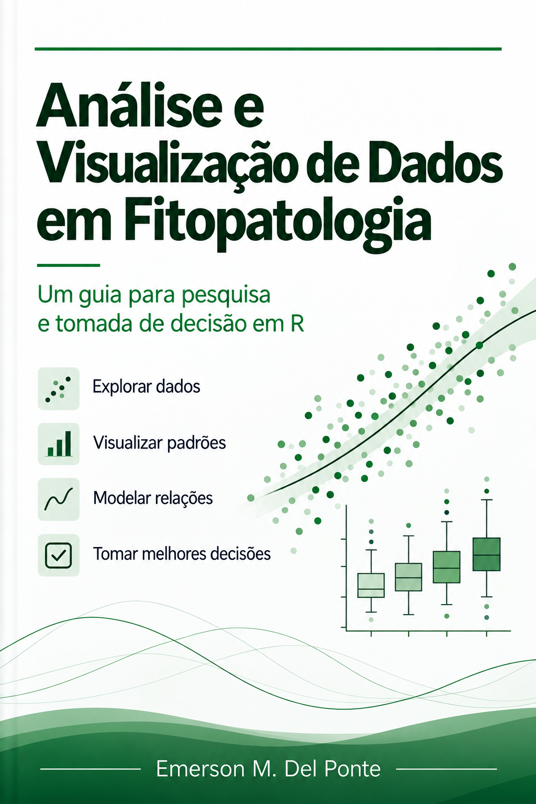

# Análise e Visualização de Dados em Fitopatologia

<p align="center">
  
</p>

<p align="center">
  <strong>Emerson M. Del Ponte</strong><br>
  <em>Universidade Federal de Viçosa (UFV) — Departamento de Fitopatologia</em>
</p>

<p align="center">
  <a href="https://emdelponte.github.io/analise-dados-fitopatologia/"></a>
  <a href="https://creativecommons.org/licenses/by-nc/4.0/"></a>
  
  
</p>

---

## 📖 Sobre o Livro

A Fitopatologia é uma ciência cada vez mais quantitativa. Avanços em técnicas experimentais, biologia molecular, monitoramento ambiental, sensoriamento remoto e processamento de imagens geram conjuntos de dados volumosos, heterogêneos e complexos. Ao mesmo tempo, a prática científica moderna exige análises rigorosas, transparentes e reprodutíveis.

Este livro originou-se das notas de aula da disciplina de pós-graduação **Análise e Visualização de Dados em Fitopatologia**, ministrada no Programa de Pós-Graduação em Fitopatologia da **Universidade Federal de Viçosa (UFV)**.

Em vez de tratar a estatística como uma coleção isolada de receitas ou testes de significância, o livro aborda a análise de dados como componente indissociável da investigação científica: da formulação de hipóteses biológicas ao delineamento experimental, organização dos dados (*tidy data*), visualização eficaz, modelagem estatística, interpretação biológica e comunicação clara dos resultados.

Todos os exemplos utilizam a linguagem **R** e foram concebidos a partir de problemas e cenários reais da pesquisa fitopatológica e agronômica.

---

## 🌐 Acesso Online

O conteúdo completo do livro está publicado e disponível gratuitamente em:

👉 **[https://emdelponte.github.io/analise-dados-fitopatologia/](https://emdelponte.github.io/analise-dados-fitopatologia/)**

---

## 📚 Estrutura dos Capítulos

O livro está estruturado em 13 capítulos pedagógicos formulados a partir de perguntas centrais do ciclo de pesquisa:

| Capítulo | Título | Pergunta norteadora & Conteúdo |
| :---: | :--- | :--- |
| **1** | [Pesquisa em Fitopatologia](chapter1.qmd) | *Por que pesquisar em Fitopatologia?*<br>O escopo da ciência das doenças de plantas, ambientes de estudo (*in vitro*, *in planta*, campo, paisagem) e escalas espaciais/temporais. |
| **2** | [Delineamento de estudos](chapter2.qmd) | *Como delinear um estudo?*<br>Tradução de hipóteses biológicas, fatores e tratamentos, unidade experimental vs. amostral, repetição, casualização, blocos e armadilhas como a pseudorrepetição. |
| **3** | [Organização dos dados](chapter3.qmd) | *Como os dados científicos devem ser organizados?*<br>Princípios de dados organizados (*tidy data*), separação entre dados brutos e derivados, metadados e boas práticas de planilhas. |
| **4** | [Análise exploratória](chapter4.qmd) | *O que os dados revelam?*<br>Inspeção visual preliminar, distribuições, anomalias, dados ausentes e identificação de padrões antes da modelagem formal. |
| **5** | [Visualização de dados](chapter5.qmd) | *Como visualizar dados de forma eficaz?*<br>Gramática dos gráficos com `{ggplot2}`, princípios de percepção visual, superação dos gráficos de barra para dados contínuos e comunicação gráfica precisa. |
| **6** | [Inferência estatística](chapter6.qmd) | *Como tiramos conclusões científicas?*<br>Compreensão da incerteza, variabilidade amostral, limites do valor-*p*, intervalos de confiança e raciocínio científico sob incerteza. |
| **7** | [Comparação de grupos](chapter7.qmd) | *Como comparamos grupos?*<br>Testes t, ANOVA (DIC e DBC), esquemas fatoriais, contrastes a priori e comparações múltiplas com `{emmeans}`. |
| **8** | [Relações entre variáveis](chapter8.qmd) | *Como estudamos relações entre variáveis?*<br>Correlação linear, regressão linear simples e múltipla, pressupostos, diagnósticos de resíduos e lições do Quarteto de Anscombe. |
| **9** | [Respostas não lineares](chapter9.qmd) | *Como analisamos respostas não lineares?*<br>Modelos não lineares e biológicos, curvas de dose-resposta, cálculo de CE50 via `{drc}` e modelagem do efeito da temperatura sobre o crescimento fúngico. |
| **10** | [Dados categóricos e de contagem](chapter10.qmd) | *Como analisamos dados categóricos e de contagem?*<br>Modelos Lineares Generalizados (GLM), regressão logística para incidência/proporções, dados de contagem (Poisson e quasipoisson) e diagnóstico com `{DHARMa}`. |
| **11** | [Dados multivariados](chapter11.qmd) | *Como exploramos dados multivariados?*<br>Análise de Componentes Principais (ACP/PCA), matrizes de distância/similaridade, agrupamento hierárquico e *heatmaps* com `{vegan}`, `{cluster}` e `{pheatmap}`. |
| **12** | [Comunicação dos resultados](chapter12.qmd) | *Como os resultados científicos devem ser comunicados?*<br>Tabelas claras, figuras de qualidade para publicação, redação científica precisa e integração entre evidência empírica e interpretação biológica. |
| **13** | [Pesquisa reprodutível](chapter13.qmd) | *Como tornar a pesquisa totalmente reprodutível?*<br>Construção de fluxos de trabalho transparentes, uso do Quarto, organização de projetos com caminhos relativos (`{here}`), controle de versão e princípios FAIR. |

---

## 🛠️ Tecnologias e Pacotes Utilizados

O livro é escrito e renderizado usando **[Quarto](https://quarto.org/)** e **[R](https://www.r-project.org/)**. Os principais pacotes do ecossistema R abordados incluem:

- **Manipulação e Organização:** `tidyverse` (`dplyr`, `tidyr`, `readr`, `tibble`, `purrr`)
- **Visualização de Dados:** `ggplot2`, `scales`, `pheatmap`
- **Modelagem e Inferência:** `emmeans`, `drc`, `lme4`, `glmmTMB`, `MASS`, `ordinal`, `DHARMa`
- **Ecologia Numérica e Multivariada:** `vegan`, `cluster`
- **Reprodutibilidade e Gestão de Projetos:** `here`, `rmarkdown`, `knitr`

---

## 💻 Como Reproduzir Localmente

Para clonar o projeto e renderizar o livro no seu computador:

### 1. Pré-requisitos
- **[R](https://cloud.r-project.org/)** (versão $\ge$ 4.3 recomendada)
- **[RStudio](https://posit.co/download/rstudio-desktop/)** ou **[Positron](https://positron.posit.co/)**
- **[Quarto CLI](https://quarto.org/docs/get-started/)** (versão $\ge$ 1.4)

### 2. Clonar o repositório
```bash
git clone https://github.com/emdelponte/analise-dados-fitopatologia.git
cd analise-dados-fitopatologia
```

### 3. Instalar pacotes do R
No console do R, execute:
```r
install.packages(c(
  "tidyverse", "emmeans", "drc", "vegan",
  "cluster", "pheatmap", "DHARMa", "MASS",
  "lme4", "glmmTMB", "ordinal", "here"
))
```

### 4. Renderizar ou pré-visualizar
Você pode visualizar o livro interativamente enquanto edita:
```bash
quarto preview
```
Ou compilar todo o livro (a saída será gerada na pasta `docs/`):
```bash
quarto render
```

---

## 📄 Licença

Este material é distribuído sob a licença **[Creative Commons Atribuição-NãoComercial (CC BY-NC 4.0)](https://creativecommons.org/licenses/by-nc/4.0/deed.pt_BR)**. Você tem a liberdade de compartilhar e adaptar o conteúdo para fins educacionais e não comerciais, desde que conceda o devido crédito ao autor.

---

## ✉️ Contato e Contribuições

Sugestões, correções e feedbacks são muito bem-vindos! Sinta-se à vontade para abrir uma [Issue](https://github.com/emdelponte/analise-dados-fitopatologia/issues) ou enviar um *Pull Request*.
